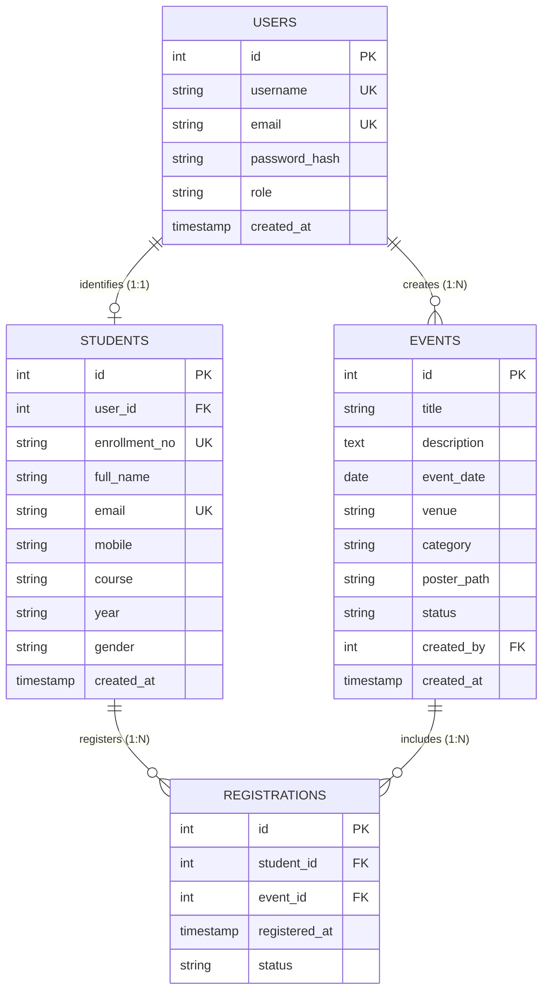

# Entity-Relationship (ER) Model - Student Hub Portal

## 1. Relational Entities & Attributes

### 1. `users` Table (Authentication & Access Control)
- `id` (INT, Primary Key, Auto Increment)
- `username` (VARCHAR(50), Unique, Not Null)
- `email` (VARCHAR(100), Unique, Not Null)
- `password_hash` (VARCHAR(255), Not Null) - Bcrypt hash via `password_hash()`
- `role` (ENUM('admin', 'student'), Default 'student')
- `created_at` (TIMESTAMP, Default CURRENT_TIMESTAMP)

### 2. `students` Table (Student Academic Profiles)
- `id` (INT, Primary Key, Auto Increment)
- `user_id` (INT, Foreign Key referencing `users(id)`, Nullable, On Delete Set Null)
- `enrollment_no` (VARCHAR(20), Unique, Not Null)
- `full_name` (VARCHAR(100), Not Null)
- `email` (VARCHAR(100), Unique, Not Null)
- `mobile` (VARCHAR(15), Not Null)
- `course` (VARCHAR(50), Not Null)
- `year` (VARCHAR(20), Not Null)
- `gender` (VARCHAR(10), Not Null)
- `created_at` (TIMESTAMP, Default CURRENT_TIMESTAMP)

### 3. `events` Table (University Events Directory)
- `id` (INT, Primary Key, Auto Increment)
- `title` (VARCHAR(150), Not Null)
- `description` (TEXT, Not Null)
- `event_date` (DATE, Not Null)
- `venue` (VARCHAR(100), Not Null)
- `category` (VARCHAR(50), Not Null)
- `poster_path` (VARCHAR(255), Nullable) - Stored in `uploads/posters/`
- `status` (ENUM('upcoming', 'completed', 'cancelled'), Default 'upcoming')
- `created_by` (INT, Foreign Key referencing `users(id)`, Nullable, On Delete Set Null)
- `created_at` (TIMESTAMP, Default CURRENT_TIMESTAMP)

### 4. `registrations` Table (Student-Event Many-to-Many Bridge)
- `id` (INT, Primary Key, Auto Increment)
- `student_id` (INT, Foreign Key referencing `students(id)`, On Delete Cascade)
- `event_id` (INT, Foreign Key referencing `events(id)`, On Delete Cascade)
- `registered_at` (TIMESTAMP, Default CURRENT_TIMESTAMP)
- `status` (ENUM('confirmed', 'attended', 'cancelled'), Default 'confirmed')
- Unique Constraint: `(student_id, event_id)` prevents duplicate bookings.

---

## 2. Cardinality & Relationships
- **User to Student (1 : 1 / 0..1)**: Each user account with role `'student'` can be associated with at most one student profile record via `students.user_id`.
- **User to Events (1 : N)**: An administrator user creates and manages multiple event records via `events.created_by`.
- **Student to Event Registrations (M : N)**:
  - One student can register for zero or many events.
  - One event can have zero or many student registrations.
  - Resolved through the `registrations` associative bridge table.

---

## 3. Mermaid ER Diagram

---

## 4. Normalization Status
- **1NF**: All table columns are atomic; no repeating groups.
- **2NF**: All non-key attributes are fully functionally dependent on the entire primary key.
- **3NF**: No transitive dependencies exist. Attributes like student personal info depend directly on `student_id`.
